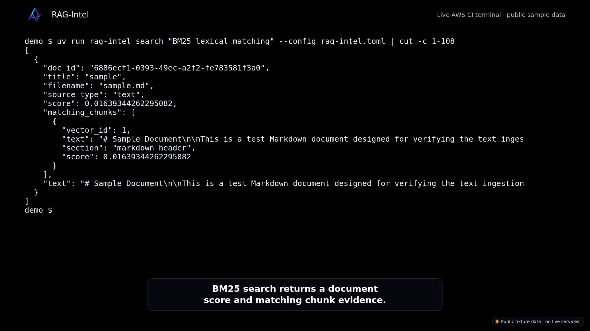

# RAG-Intel

[](https://github.com/ayush108108/RAG-Intel/actions/workflows/ci.yml)
[](https://www.python.org/)
[](LICENSE)
[](docs/PUBLIC_BOUNDARY.md)

**A transparent local retrieval engine where every ranking decision is visible.**

RAG-Intel turns files into inspectable retrieval results using bounded chunking, BM25, optional SentenceTransformers + FAISS, reciprocal-rank fusion, SQLite state, and optional cross-encoder reranking. It is a modern reference engine—not a framework hiding three API calls behind magic.

> **No API key. No hosted vector database. No silent ranking defaults.**

## Status

**Prototype** — runs locally and in a demo; not relied on by anyone and not offered as a service.

This repository is a library-shaped extract of retrieval-engineering primitives from a larger private document-intelligence system. It intentionally contains no private benchmarks, production configuration, HTTP APIs, product UI, or deployment material; see [`docs/PUBLIC_BOUNDARY.md`](docs/PUBLIC_BOUNDARY.md) and [`docs/ARCHITECTURE.md`](docs/ARCHITECTURE.md).

## Demo

Every number in the video is output of the bundled sample data or a paper simulation on synthetic data, not a result or a performance claim.

[](docs/demo/demo.mp4)

The recording shows an explicit lexical policy, bundled Markdown ingestion, matching chunk evidence, SQLite index status, offline evaluation, and test output.

Reproduce the recorded lexical workflow after the [quickstart setup](#five-minute-tour):

```bash
cp config/community.lexical.toml rag-intel.toml
cat rag-intel.toml
uv run rag-intel ingest sample_data/sample.md --config rag-intel.toml
uv run rag-intel search "BM25 lexical matching" --config rag-intel.toml | cut -c 1-108
uv run rag-intel status --config rag-intel.toml
uv run python examples/eval_quickstart.py
uv run pytest -o addopts= -q
```

## Why it feels different

- **Policy is code:** fusion, aggregation, candidate depth, and result limits are selected explicitly.
- **Chunks stay bounded:** overlap is included inside the requested chunk size.
- **State survives restarts:** document/chunk identity lives in SQLite; FAISS metadata validates model and dimensions.
- **Recoverable SQLite job state:** recovery can requeue queued jobs whose source files still exist; interrupted processing is marked failed rather than resumed.
- **Core stays offline:** lexical workflows and tests need no model download or network access.
- **Adapters stay optional:** install PDF/OCR, dense retrieval, and reranking only when needed.

```text
files → extract → normalize → bounded chunks ─┬→ BM25 ──────────┐
                                              └→ embeddings → FAISS ─┤
                                                                     ▼
                                                       explicit strategy policy
                                                                     ▼
                                                    document results + evidence
```

## Five-minute tour

### 1. Install

```bash
uv sync --all-extras
```

For the offline lexical core only:

```bash
uv sync --extra dev
```

### 2. Choose policy

Start with the offline lexical policy (deliberately illustrative, not optimal):

```bash
cp config/community.lexical.toml rag-intel.toml
```

Every consequential choice is present in TOML. For an optional dense setup, see `config/research.example.toml`.

### 3. Index and search

```bash
uv run rag-intel ingest sample_data/sample.md --config rag-intel.toml
uv run rag-intel search "retrieval policy" --config rag-intel.toml
uv run rag-intel status --config rag-intel.toml
```

Results are JSON with document identity, scores, and matching chunks—easy to inspect, pipe, and test.

## Reproducible proof

The checked-in offline smoke benchmark uses 4 redistributable documents and 4 explicit relevance judgments. On the recorded Ubuntu/Azure x86_64 run (Python 3.12.1, 30 runs/query):

| Metric | Result |
|---|---:|
| Recall@3 | 1.000 |
| nDCG@3 | 1.000 |
| MRR | 1.000 |
| Query latency p50 | 0.567 ms |
| Query latency p95 | 0.781 ms |

Reproduce it—not just read it:

```bash
uv run rag-intel benchmark benchmarks/lexical-smoke-v1.json \
    --config config/benchmark.lexical.toml \
    --k 3 --runs 30 --warmup-runs 3 \
    --output benchmarks/results/lexical-smoke-v1.json
```

The full report includes every query, relevance label, ranking, metric, configuration value, software version, and hardware platform. This proves the benchmark contract and local lexical pipeline on a tiny smoke corpus; it does **not** establish broad state-of-the-art retrieval quality. See [`docs/RESULTS.md`](docs/RESULTS.md).

For a no-config, fully offline per-query metric table (precision@k, recall@k, reciprocal rank) over a bundled 8-document corpus with ground truth:

```bash
uv run python examples/eval_quickstart.py
```

## Python API

```python
from pathlib import Path

from rag_intel import RAGIntelEngine
from rag_intel.config import EngineSettings
from rag_intel.retrieval import (
    MaxScoreAggregator,
    ReciprocalRankFusion,
    RetrievalPolicy,
    TopKSelector,
)

settings = EngineSettings(
    data_dir=Path("./data/demo"),
    retrieval_mode="lexical",
    chunk_size=640,
    chunk_overlap=64,
    max_ingest_size_mb=25,
    embedding_model=None,
    embedding_batch_size=16,
    enable_reranking=False,
    reranker_model=None,
)
policy = RetrievalPolicy(
    candidate_depth=40,
    fusion=ReciprocalRankFusion(rank_constant=60),
    aggregate=MaxScoreAggregator(),
    select=TopKSelector(limit=8),
)

engine = RAGIntelEngine(settings, policy)
engine.ingest("sample_data/sample.md")
results = engine.search("transparent retrieval")
```

Reference strategies are intentionally standard and opt-in. Applications can implement the small strategy protocols in `rag_intel.retrieval.strategies` without replacing the engine.

## Supported inputs

| Format | Core/extra | Adapter |
|---|---|---|
| TXT, Markdown, JSON, CSV | Core | Python standard library |
| HTML | `parsers` | Beautiful Soup |
| PDF | `parsers` | PyMuPDF |
| PNG/JPEG/TIFF/BMP/GIF | `parsers` + system Tesseract | Pillow + pytesseract |

## CLI

| Command | Purpose |
|---|---|
| `rag-intel ingest` | Extract, normalize, chunk, and index a file |
| `rag-intel search` | Return ranked documents and matching evidence |
| `rag-intel delete` | Remove a document from local stores |
| `rag-intel status` | Show document, chunk, and failed-job counts |
| `rag-intel evaluate` | Calculate Precision@k, Recall@k, and reciprocal rank |
| `rag-intel benchmark` | Run a manifest and emit quality/latency evidence |
| `rag-intel version` | Show the installed version |

## Community map

Good first contributions include parser fixtures, Unicode tokenization, additional standard strategy implementations, evaluation datasets with clear redistribution rights, and failure-injection tests.

- Read [`CONTRIBUTING.md`](CONTRIBUTING.md) before opening a PR.
- Understand the extension contract in [`docs/PUBLIC_BOUNDARY.md`](docs/PUBLIC_BOUNDARY.md).
- See architecture trade-offs in [`docs/ARCHITECTURE.md`](docs/ARCHITECTURE.md).
- Security reports follow [`SECURITY.md`](SECURITY.md).

## Honest scope

RAG-Intel is retrieval infrastructure, not a generation service. It does not include LLM prompts, agents, hosted APIs, authentication, production scheduling, or claims of universal state-of-the-art quality. Benchmark results are meaningful only for a named corpus and configuration.

## Sample data

- `sample_data/eval/` — an 8-document corpus with ground-truth queries, written for this repository, used by `examples/eval_quickstart.py`.
- `sample_data/sample.*` — small files exercising each supported format (`sample.html` is a saved W3C page used as an HTML fixture).
- `sample_data/load_test/` — larger third-party fixtures (Project Gutenberg text, Python documentation pages, public CSV datasets including `airport_codes.csv`, and a Tesseract test image). Sources are listed in `scripts/download_load_test_data.py`; each source retains its own terms rather than the repository's MIT licence. The bundled airport-code fixture excludes street-address-shaped site names.
- The three arXiv papers and the Sherlock Holmes text are **download-only**, excluded from the repository and its clean release history. Fetch them when needed with `python scripts/download_load_test_data.py`. The script lists the paper source URLs and links to their licence terms. The arXiv non-exclusive distribution licence grants rights to arXiv, not a blanket right for this project to redistribute the PDFs; review each paper's current terms before reuse or redistribution. The downloaded text may contain third-party contact details in its original notices; keep these local fixtures out of releases.

## Development

```bash
uv sync --extra dev --frozen
uv run ruff check src tests
uv run ruff format --check src tests
uv run pytest -q
uv build
```

MIT licensed. Built for people who want to understand—and improve—their retrieval stack.
